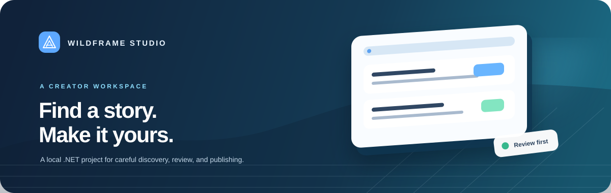
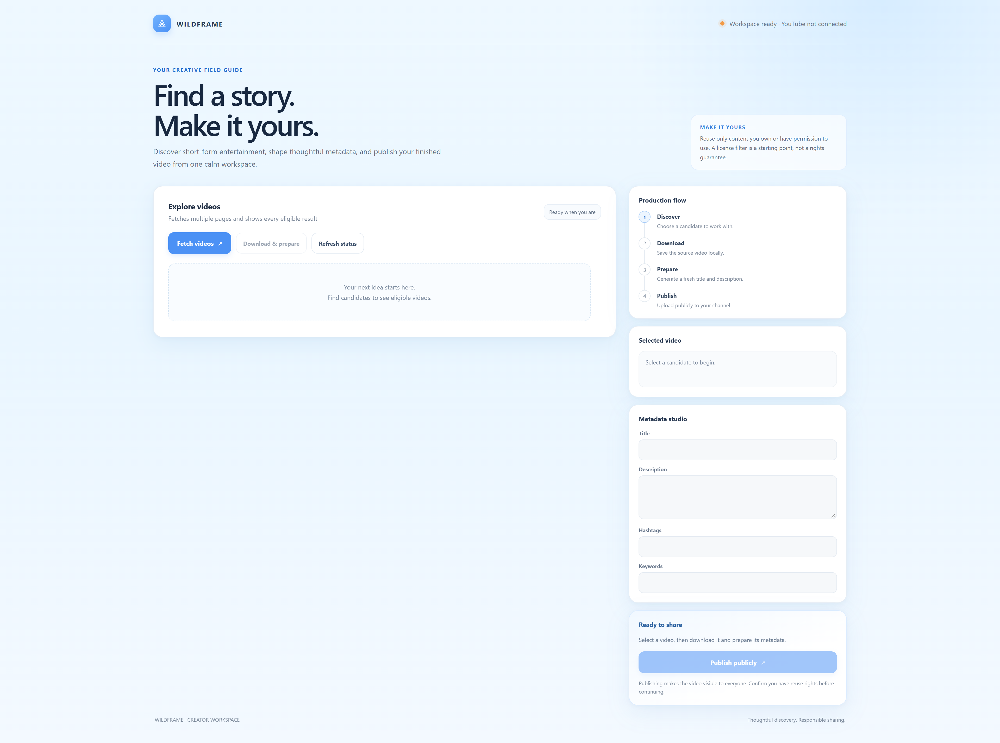
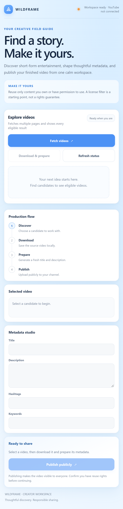
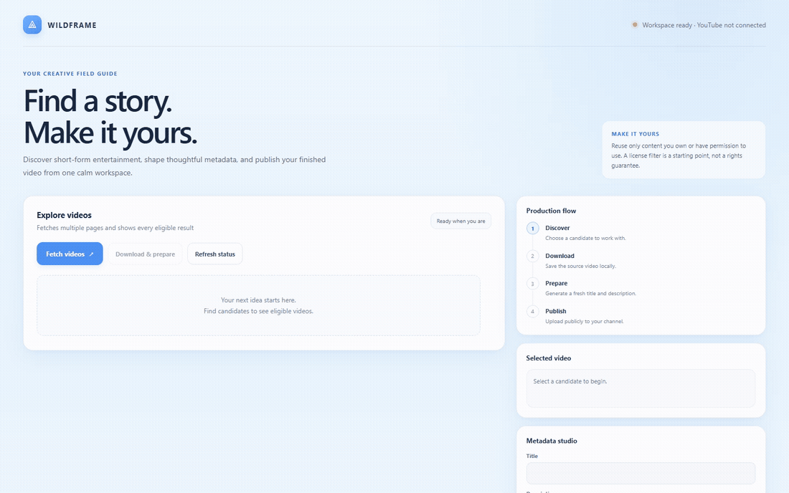

<div align="center">



<br>

**A local .NET creator-workflow prototype for discovering, preparing, and reviewing short-form video uploads.**

<br>

[Quick start](#quick-start) · [Screenshots](#screenshots) · [Configuration](#configuration) · [Platform and rights notice](#platform-and-rights-notice)

</div>

> **Project status:** This is a personal software project. The project owner states that it currently generates no revenue. That describes the project’s status; it does not change platform rules or provide protection from claims, restrictions, or enforcement.

## Screenshots

The web app is a single-page workspace. These captures show the same page at desktop and mobile sizes. The desktop image is a full-page, 4K-width capture; the mobile image shows its responsive layout.

<p align="center">
  
</p>

[Open the 3840 × 2160 desktop viewport capture](docs/screenshots/wildframe-home-4k-viewport.png).

<details>
<summary>Mobile layout</summary>

<p align="center">
  
</p>

</details>

### Short walkthrough

<p align="center">
  
</p>

The walkthrough is a lightweight 10 fps GIF. The full-resolution screenshots are the sharp reference images.
For the original browser recording, open the [WebM walkthrough](docs/screenshots/wildframe-walkthrough-final.webm).

## What it does

Wildframe Studio is a local .NET application with a browser interface and a separate .NET MAUI shell. The web workspace groups the following steps in one page:

1. **Discover** candidate videos through the YouTube Data API using the current search filters in `ShortsFetcher.cs`.
2. **Review** the returned candidate list and select one item.
3. **Download** a selected video with `yt-dlp` to the local `Downloads/` directory.
4. **Prepare** suggested title, description, hashtags, and keywords with Groq.
5. **Publish** through the YouTube Data API. The current uploader sets visibility to **public**.

The MAUI shell has Home, Discover, Insights, Activity, and Settings tabs. Its integration notes are in [`mobile/README.md`](mobile/README.md).

## Quick start

### Prerequisites

- .NET 10 SDK
- A Google OAuth desktop client JSON file with the YouTube Data API enabled
- A Groq API key for metadata generation
- `yt-dlp` and FFmpeg available on `PATH` for the download/merge step

The YouTube OAuth client secret and `.env` file stay local and are ignored by Git.

### Configure

From the repository root, create the local environment file:

```powershell
Copy-Item .env.example .env
```

Edit `.env` and set the Groq key and absolute OAuth JSON path. Keep the credentials private and do not commit `.env`, `client_secret.json`, or generated OAuth tokens.

```dotenv
GROQ_API_KEY=replace_with_your_key
GROQ_BASE_URL=https://api.groq.com/openai/v1
GROQ_MODEL=openai/gpt-oss-20b
YOUTUBE_REGION=IN
YOUTUBE_CLIENT_SECRET_PATH=C:\absolute\path\to\client_secret.json
```

`YOUTUBE_CLIENT_SECRET_PATH` is the file path used by `YouTubeAuth`. The first authorized YouTube action opens Google's OAuth flow and stores a local token under `YouTube.Token.Store/`.

### Build and run the web workspace

```powershell
dotnet build .\frontend\YouTubeAutomation.Web.csproj
dotnet run --project .\frontend\YouTubeAutomation.Web.csproj
```

Open <http://127.0.0.1:5077>. The web host binds to loopback for local use. Its lightweight status endpoint is <http://127.0.0.1:5077/api/status>.

### Run the console workflow

```powershell
dotnet run --project .\YouTubeAutomation.csproj
```

### Build the MAUI shell

Windows:

```powershell
dotnet build .\mobile\YouTubeAutomation.Mobile.csproj -f net10.0-windows10.0.19041.0
```

Android also requires a working JDK and Android SDK. See [`mobile/README.md`](mobile/README.md) for setup and emulator notes.

## Configuration

| Variable | Purpose |
| --- | --- |
| `GROQ_API_KEY` | Authenticates metadata-generation requests. |
| `GROQ_BASE_URL` | Groq-compatible chat completions endpoint. |
| `GROQ_MODEL` | Model name sent with metadata requests. |
| `YOUTUBE_CLIENT_SECRET_PATH` | Absolute path to the Google OAuth client JSON file. |
| `YOUTUBE_REGION` | Optional region code for candidate search; defaults to `IN`. |

The application uses OAuth credentials from `YOUTUBE_CLIENT_SECRET_PATH` for authorized YouTube actions. The `YOUTUBE_API_KEY` value found in some existing local `.env` files is not currently read by this codebase.

## Project map

| Path | Role |
| --- | --- |
| `YouTubeAutomation.csproj` | Shared services and console workflow. |
| `frontend/` | ASP.NET Core local API and one-page web UI. |
| `mobile/` | .NET MAUI shell for Windows and Android. |
| `YouTubeAuth.cs` | OAuth flow and token storage. |
| `ShortsFetcher.cs` | YouTube Data API search and candidate filtering. |
| `VideoDownloader.cs` | `yt-dlp` download process. |
| `MetadataRewriter.cs` / `GroqService.cs` | Metadata prompt and Groq request. |
| `YouTubeUploader.cs` | YouTube Data API upload; currently sets public visibility. |
| `docs/screenshots/` | README screenshots and walkthrough. |

## Platform and rights notice

This app is **not affiliated with or endorsed by YouTube or Google**. It is a software experiment, not a way to bypass copyright, YouTube's Terms, API policies, or channel enforcement.

The current workflow includes automated searching, a `yt-dlp` download step, metadata generation, and a public upload action. YouTube's Terms restrict automated access and downloading except where the Service expressly authorizes it or YouTube and any relevant rights holders give prior permission. A Creative Commons search filter is not a blanket download or re-upload permission. Check both the platform authorization and the complete rights for the video, audio, music, artwork, and people shown before using any item. See [YouTube Terms of Service](https://www.youtube.com/t/terms), [YouTube API Services Developer Policies](https://developers.google.com/youtube/terms/developer-policies), and [YouTube's copyright guidance](https://support.google.com/youtube/answer/2797466).

Before any public upload, review the source, license conditions, attribution requirements, privacy, and the finished video yourself. The current uploader publishes publicly; this app does not establish that an upload is lawful or policy-compliant. A non-commercial or zero-revenue status, disclaimer, attribution, or license filter does not provide immunity. Content may be removed, channel features or monetization may be restricted, and repeated or severe violations can lead to channel termination. Read YouTube's [Community Guidelines](https://support.google.com/youtube/answer/9288567) and [channel enforcement guidance](https://support.google.com/youtube/answer/2797387) before using the publish action.

For a shared or deployed API client, YouTube's developer policies also require clear user-facing terms and a privacy policy. This repository is currently configured as a local development prototype; review those requirements before distributing or exposing it to other users.

## Security notes

- `.env`, `client_secret.json`, OAuth token files, and build outputs are excluded by `.gitignore`.
- Use credentials you control, request only scopes the application needs, and revoke credentials if they are exposed.
- The local web server binds to `127.0.0.1`; do not expose it to a network without adding appropriate authentication, HTTPS, and privacy controls.
- Publishing is an external, public action. Read the final metadata and verify rights before selecting **Publish publicly**.

## Verification

Verified in the current workspace:

- `dotnet build YouTubeAutomation.csproj --no-restore` — passed.
- `dotnet build frontend\YouTubeAutomation.Web.csproj --no-restore` — passed.
- `dotnet build mobile\YouTubeAutomation.Mobile.csproj -f net10.0-windows10.0.19041.0 --no-restore` — passed.
- Local `/api/status` responded successfully and reported the web service online.

The Android build was not verified on this machine because an Android SDK and a valid JDK installation were not available.

---

<div align="center">

**Wildframe Studio** · thoughtful discovery · responsible sharing

</div>
